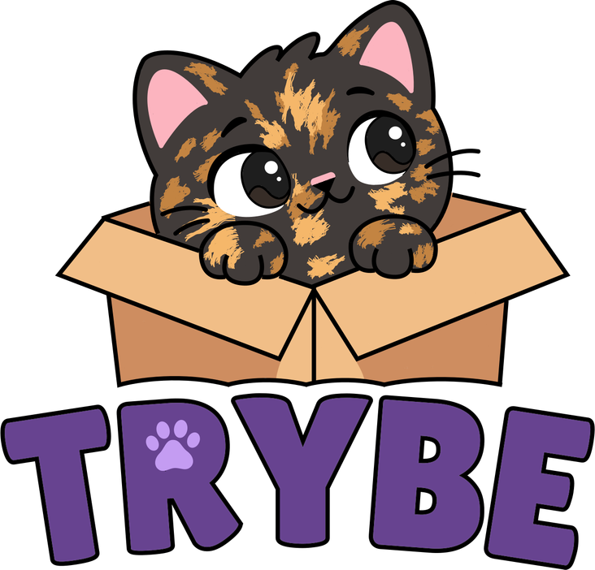

<p align="center">
  
</p>

<h1 align="center">Trybe</h1>

<p align="center"><em>Curiosity killed the cat. Trybe brought it back.</em></p>

<p align="center">
  
  
  
  
  
  
  
  
  
  
  
  
</p>

Trybe is a mobile-first app for trading hobby tools and equipment. Post photos of what you've made along with the tools you used, browse a feed by hobby, and propose trades on tagged items: item for item, or with a cash or item top-up when the values don't match.

Trust comes from ratings, trade history, account age, email verification, and a "new trader" badge. Trybe doesn't handle payments or shipping. Cash top-ups are agreed in the app and settled in person.

## Status

Version **0.5.0**. Phases 0 to 3 are done (accounts, profiles, items, posts, feed, and the full trade flow from offer to accept). Phase 4's backend is done too: chat with live updates, message requests, meetups at safe spots, completing a trade, ratings, and notifications. The mobile app (Phase M) can log in with tokens. Live at <https://trybe-puce.vercel.app>, running on the dev database. See [the implementation plan](docs/implementation-plan.md) and the [changelog](CHANGELOG.md).

## Team

- **Lhenna**: design and frontend
- **Tristan**: backend

## Tech stack

**Website and API**

| Area | Choice |
| --- | --- |
| Framework | Next.js 16 (App Router, `src/`), React 19 |
| Language | TypeScript, strict mode |
| Styling | Tailwind CSS 4, design tokens in `src/app/globals.css` ([design guide](src/styles/DESIGN.md)) |
| Fonts | Lilita One (headings, wordmark), Nunito (body and UI) |
| Database | PostgreSQL on Supabase, Drizzle ORM and migrations |
| Critical operations | Postgres functions with row locking (trades, ratings), audit log triggers, pg_cron jobs |
| Validation | Zod, contracts shared by the website, the app, and the server in `src/shared/` |
| Auth | Supabase Auth with email verification. Cookies for the website, Bearer tokens for the app |
| Storage | Supabase Storage. Photos are shrunk, stripped of EXIF and GPS, and saved as WebP |
| Realtime chat | Supabase Realtime, with Row Level Security |
| Maps | Leaflet and OpenStreetMap |
| Bot protection | Cloudflare Turnstile |
| Errors | Sentry |
| Hosting | Vercel. The website is also an installable PWA |

**Mobile app** (`mobile/`, decided 2026-11-18)

| Area | Choice |
| --- | --- |
| Framework | Expo (React Native), Expo Router |
| Styling | NativeWind with the same design tokens |
| Data | TanStack Query with the shared Zod contracts |
| Session | `expo-secure-store`, Bearer token |
| Releases | EAS Build and EAS Submit to Google Play |

**Testing**

| Kind | Tool |
| --- | --- |
| Unit and integration | Vitest, with a local Supabase stack in Docker |
| End to end | Playwright (website), Maestro (app) |
| Performance | k6 |

Full details are in [the technical requirements](docs/technical-requirements.md).

## Setup

You need Node.js 22.13 or newer and pnpm. **Use pnpm only.** Never npm or yarn, and never commit `package-lock.json`.

```bash
corepack enable          # gives you the pnpm version pinned in package.json
pnpm install
cp .env.example .env.local
```

Fill in `.env.local` with the Supabase dev project values (ask Tristan). The app runs without them, but anything that touches the database won't.

```bash
pnpm dev                 # http://localhost:3000
```

Check the database connection at <http://localhost:3000/api/health>.

## Commands

| Command            | Does                                                         |
| ------------------ | ------------------------------------------------------------ |
| `pnpm dev`         | Start the dev server                                         |
| `pnpm build`       | Production build                                             |
| `pnpm lint`        | Lint                                                         |
| `pnpm typecheck`   | Generate route types and type check                          |
| `pnpm test`        | Run the unit tests once                                      |
| `pnpm test:watch`  | Run the unit tests on save                                   |
| `pnpm db:generate` | Create a migration from changes to `src/server/db/schema.ts` |
| `pnpm db:migrate`  | Apply migrations to the database in `DIRECT_DATABASE_URL`    |
| `pnpm db:studio`   | Browse the database in Drizzle Studio                        |

For SQL that Drizzle can't generate (functions, triggers, RLS policies), create an empty migration with `pnpm db:generate --custom --name=<what_it_does>` and write the SQL in it. Never edit a migration that has already been applied.

Integration, end-to-end, and performance tests have their own commands and need Docker Desktop running. They use a local test database, never the dev one. See the [testing guide](docs/testing.md#5-commands).

## Project structure

```
mobile/             Expo app (not started yet)        Lhenna
src/
├── app/            pages and layouts                 Lhenna
│   └── api/        REST route handlers (thin)        Tristan
├── components/     UI components                     Lhenna
├── server/         business logic, database          Tristan
└── shared/         Zod schemas and API contracts     Both
tests/              backend tests                     Tristan
docs/               technical docs
```

Read [AGENTS.md](AGENTS.md) before writing code. It has the architecture rules, trade rules, and safety requirements.

## Branches

- `main` is stable, reviewed work. Never push to it directly.
- Each person has one working branch: Lhenna on `frontend`, Tristan on `backend`.
- Open a pull request from your branch into `main`. Lint, type check, tests, and build must pass, and the other person reviews it. GitHub does not block the merge, so check that CI is green first. A merge into `main` deploys to production on Vercel.
- After it merges, update your branch from `main` and keep working on it.

## Versions and releases

The version lives in `package.json` and follows [semantic versioning](https://semver.org):

| Version  | When                                                   |
| -------- | ------------------------------------------------------ |
| `0.x.0`  | A phase or a big feature is done (MINOR goes up)       |
| `0.x.y`  | Fixes only (PATCH goes up)                             |
| `1.0.0`  | Play Store launch                                      |

**Every pull request** that changes what people see or how the app behaves
adds a line under **Unreleased** in [CHANGELOG.md](CHANGELOG.md), in plain
words ("Profile photos can be changed", not "add POST route").

**To release** (for example `0.2.0`), never pushing to `main` directly:

1. On your branch, after updating it from `main`:
   - In CHANGELOG.md, rename "Unreleased" to `[0.2.0] - <date>`, add an
     empty "Unreleased" above it, and update the links at the bottom.
   - Set `"version": "0.2.0"` in `package.json`.
   - Commit (`chore: release v0.2.0`), push, and open a pull request.
2. When CI is green, merge it.
3. Tag the merge commit on `main` and push only the tag:

   ```
   git switch main
   git pull
   git tag v0.2.0
   git push origin v0.2.0
   git switch backend
   ```

For the Play Store build (Phase 7), the version people see is this version,
and the build number goes up by one with every upload.

## Docs

- [AGENTS.md](AGENTS.md): short guide for people and AI tools
- [Technical requirements](docs/technical-requirements.md)
- [Implementation plan](docs/implementation-plan.md)
- [Database design](docs/database.md)
- [Testing guide](docs/testing.md)
- [Changelog](CHANGELOG.md)
- [Design guide](src/styles/DESIGN.md)
